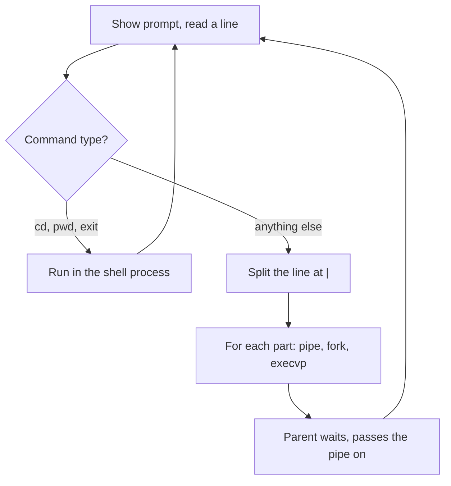

# Mini Shell

A small Linux command-line shell written in **C**. It reads commands, runs
built-in commands itself, and runs other programs with `fork` and `execvp`,
including pipelines such as `ls | grep c | wc -l`.

## Features

- Coloured prompt, with a customisable prompt using `PS1=`
- **Built-in commands:** `cd` (plain `cd` goes to the home directory), `pwd`, `exit`
- **External commands** run in a child process (`fork`, `execvp`, `waitpid`)
- **Pipes** between any number of commands (`cmd1 | cmd2 | cmd3`)
- **Ctrl+D (end of input)** exits the shell cleanly
- **Signal handling** for `SIGINT` (Ctrl+C) and `SIGTSTP` (Ctrl+Z), so the shell itself is not killed or stopped by them

## Example session

```
Minishell$: pwd
/home/user/mini-shell
Minishell$: cd /tmp
Minishell$: pwd
/tmp
Minishell$: echo hello world | tr a-z A-Z
HELLO WORLD
Minishell$: PS1=myshell>
myshell> exit
```

## How it works



1. `scan_input()` prints the prompt, reads a line and checks for a `PS1=` change.
2. `get_command()` picks out the first word, and `check_command_type()` classifies it as built-in, external or job-control.
3. Built-ins run directly in the shell process, because `cd` must change the shell's own directory.
4. For external commands, the line is split at `|`. Each part gets a `pipe()` and a `fork()`. The child connects its input and output with `dup2()`, then calls `execvp()`. The parent waits for the child and passes the read end of the pipe to the next command.

## Code structure

| File | Purpose |
|------|---------|
| `main.c` | Registers signal handlers, clears the screen and starts the shell loop |
| `main.h` | Includes, constants, colour codes and function prototypes |
| `minishell.c` | Prompt loop, command classification, built-ins, pipelines, signal handler |
| `Makefile` | Build rules |

## Build and run

```bash
make
./minishell
```

Requires a Linux system with `gcc` and `make`. Run `make clean` to remove the build output.

## Status

Not implemented yet: job control (`jobs`, `fg`, `bg`), background commands with `&`, command history and `echo $?`. [update this section as you add them]

## What I learned

- [add: how fork, exec and wait work together]
- [add: connecting processes with pipe and dup2]
- [add: one debugging problem you solved]
